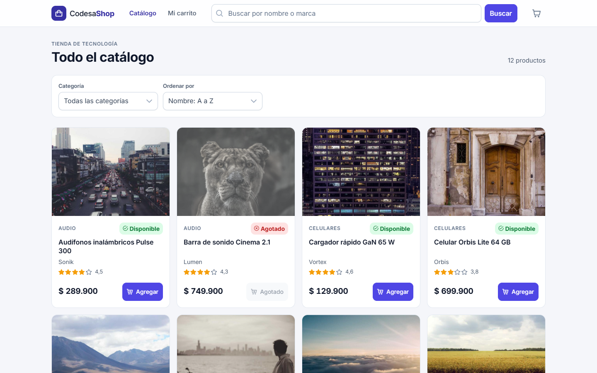
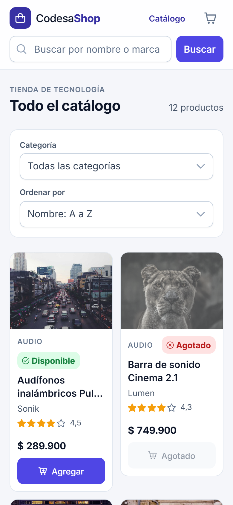
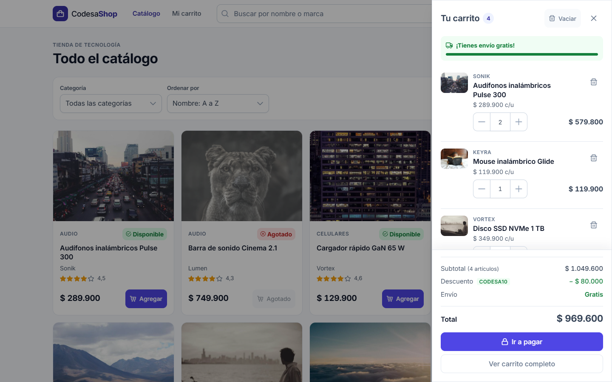
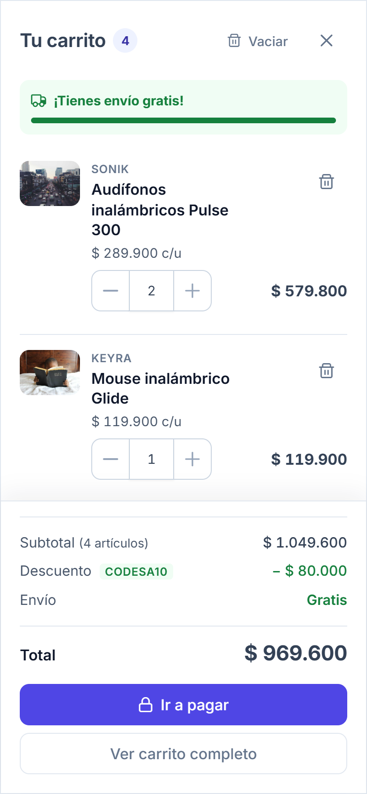
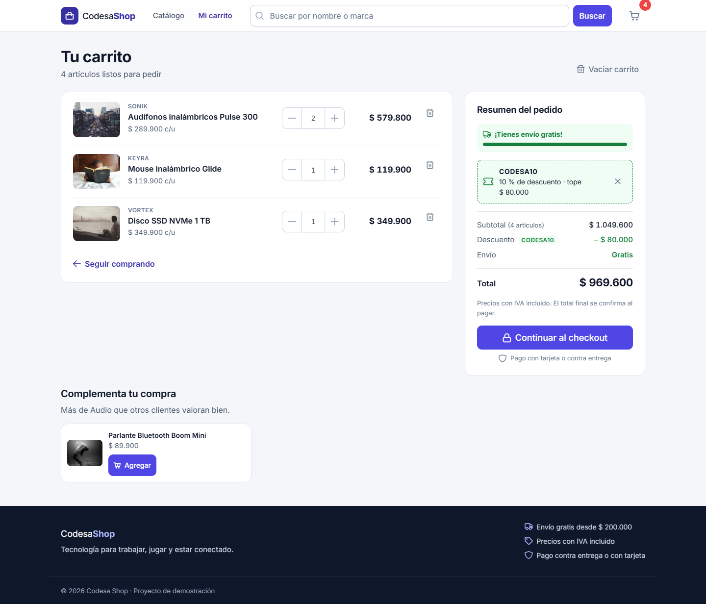
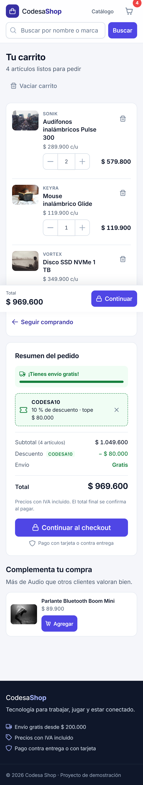
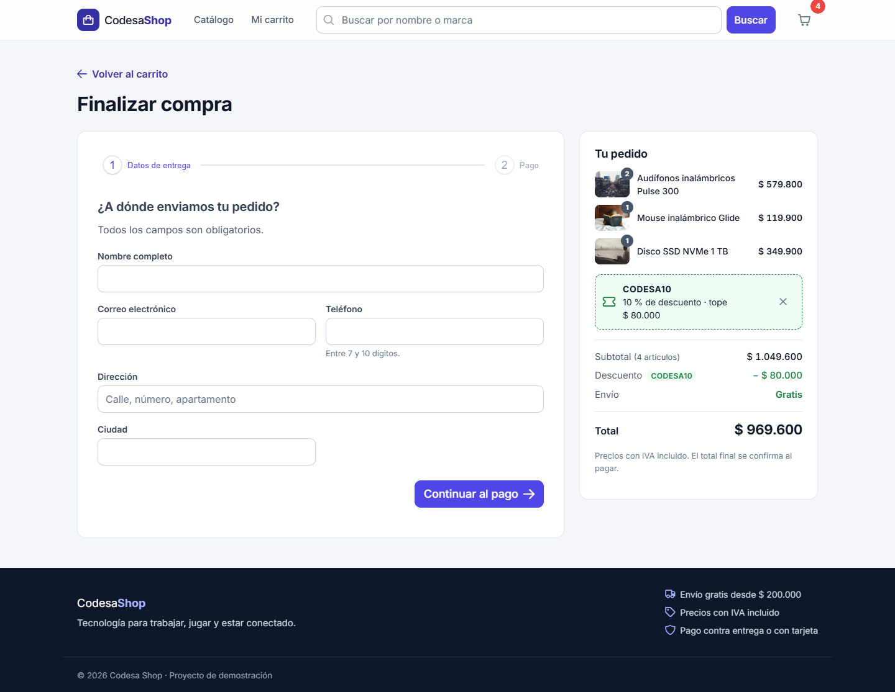
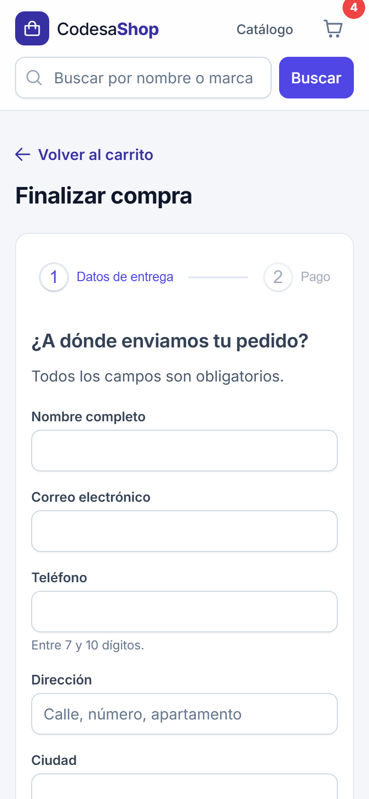
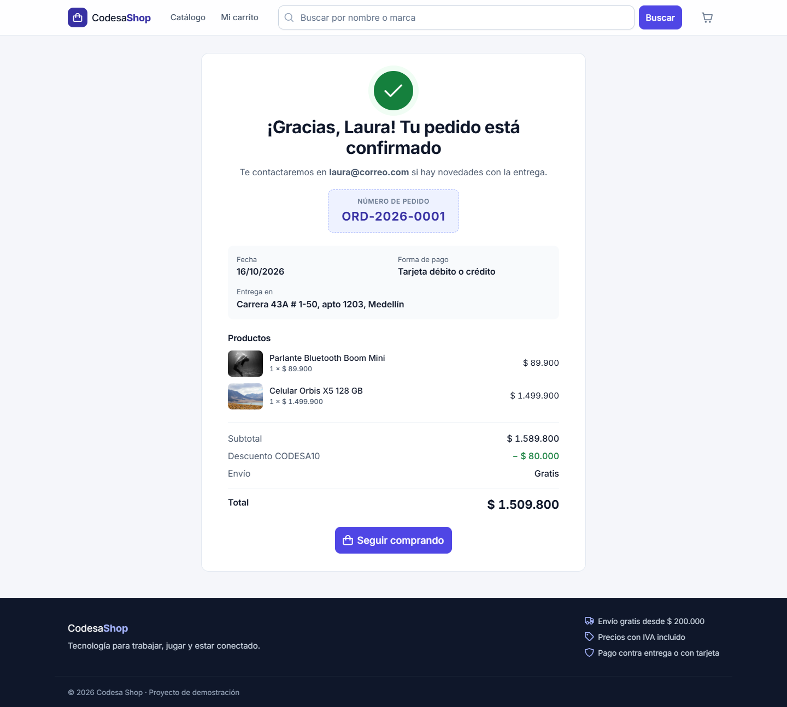
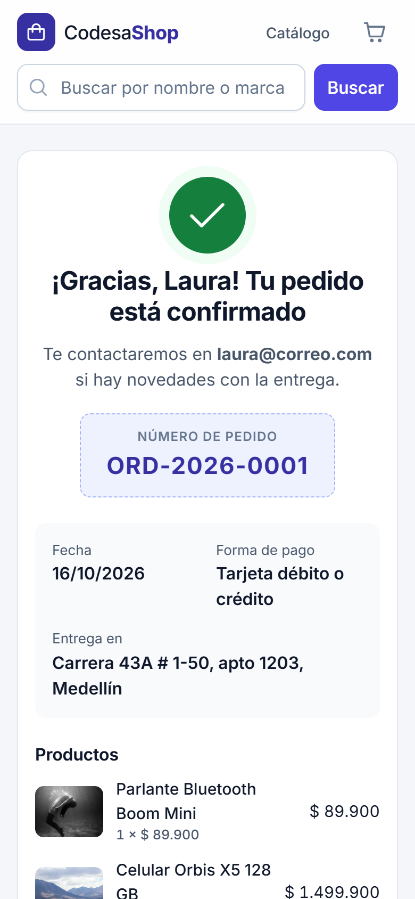

# Codesa Shop

Carrito de compras de una tienda de tecnología. El frontend está hecho en Angular 20 con PrimeNG 20 y el backend en Spring Boot 3 sobre PostgreSQL. El catálogo, los cupones y los pedidos salen de la base de datos; el navegador no inventa ningún dato.

| Escritorio | Celular |
| --- | --- |
|  |  |
|  |  |
|  |  |
|  |  |
|  |  |

Las demás capturas (detalle de producto y carrito vacío) están en [`docs/capturas`](docs/capturas).

## Cómo ejecutarlo

Solo hace falta Docker. Desde la raíz del repositorio:

```bash
docker compose up --build
```

| Servicio | URL |
| --- | --- |
| Tienda | http://localhost:4200 |
| API | http://localhost:8080/api (por ejemplo http://localhost:8080/api/products) |
| PostgreSQL | `localhost:5433`, base `codesa_shop`, usuario y clave `codesa` |

Al arrancar con la base vacía, el backend siembra 4 categorías, 12 productos y los 3 cupones antes de aceptar peticiones. Reiniciar los contenedores no borra pedidos ni devuelve stock. Para dejar todo limpio:

```bash
docker compose down -v
```

Para trabajar sin reconstruir imágenes:

```bash
docker compose up db
cd backend && ./mvnw spring-boot:run
cd frontend && npm install && npm start
```

El frontend queda en http://localhost:4200 y llama al backend en http://localhost:8080/api (CORS abierto para `http://localhost:4200`).

Revisiones de calidad del frontend: `npm run lint` (ESLint sin advertencias), `npm run format:check` (Prettier) y `npx ng build`.

## Decisiones de arquitectura

### Estructura del frontend

```
src/app
├── core/          servicios HTTP, modelos de la API, interceptor de errores, tema y título por ruta
├── cart/          todo el carrito: store, reglas, persistencia, acciones y sus componentes
│   ├── cart.store.ts          estado y totales derivados (única fuente de verdad)
│   ├── cart.rules.ts          reglas de negocio: tope por línea, envío, descuento
│   ├── cart-storage.ts        lectura y escritura en localStorage, tolerante a datos viejos
│   ├── cart-actions.service.ts  acciones del usuario con su aviso y su deshacer
│   └── components/            línea, resumen, cupón, panel lateral, mini-carrito, botón agregar
├── features/      una carpeta por pantalla, cada una cargada de forma perezosa
│   ├── catalog/  product-detail/  cart/  checkout/  order-confirmation/  not-found/
├── layout/        cabecera y pie
└── shared/        bloque de estado (vacío/error), etiqueta de stock, pipes de moneda y valoración
```

### Dónde vive el estado del carrito y por qué

El carrito vive en `CartStore`, un servicio raíz con **signals**. Hay una sola señal privada con las líneas y el cupón, y todo lo demás se deriva con `computed`: cantidad de artículos, subtotal por línea, subtotal, descuento, envío, total, cuánto falta para el envío gratis y si el cupón sigue aplicando. Los componentes solo leen esas señales y modifican el estado llamando métodos del store (`add`, `setQuantity`, `remove`, `clear`, `restore`, `applyCoupon`…). Ningún componente suma ni filtra líneas por su cuenta.

Elegí signals y no NgRx porque el estado es de un solo dominio y cabe en un servicio pequeño. Las señales derivadas resuelven justo lo que pide la prueba (totales que se recalculan solos y se reflejan al instante en el panel, en `/carrito` y en el checkout), sin acciones, reducers ni efectos que agregarían código sin aportar nada aquí. Además funcionan sin Zone.js, y la app corre en modo *zoneless*.

Las reglas (máximo 10 por línea, nunca más que el stock, envío de $ 12.900 gratis desde $ 200.000, porcentaje y tope del cupón) están en `cart.rules.ts`. Es el único archivo del frontend que las conoce.

**Persistencia.** Un `effect` guarda el estado en `localStorage` en cada cambio. Al abrir la app, `cart-storage.ts` reconstruye el carrito validando cada campo. Si el dato está corrupto, es de otra versión o trae cantidades imposibles, se descarta o se ajusta en vez de romper la app. El carrito también se sincroniza entre pestañas con el evento `storage`.

**Qué calcula el navegador y qué le pide al backend.** El navegador calcula una vista previa de los totales para que el usuario vea el efecto de cada cambio sin esperar a la red. Los cupones siempre los valida el backend (`GET /api/coupons/{code}`); el front solo guarda el cupón que el servidor aceptó. Al confirmar, el backend recalcula todo con los precios de la base, y la pantalla de confirmación muestra únicamente lo que devolvió `POST /api/orders`. Si el servidor responde `TOTAL_INCORRECTO`, el resumen se repinta con sus valores y los precios de las líneas se refrescan.

**Llamadas HTTP.** Cada recurso tiene su servicio (`ProductService`, `CategoryService`, `CouponService`, `OrderService`). La URL de la API está en un solo lugar (token `API_URL`, que lee `environment.ts`). Un interceptor centraliza dos cosas:

- Reintenta las lecturas que fallan por red o 502/503/504 con espera progresiva (600 ms y 1,2 s).
- Convierte cualquier error en un `AppError` con un mensaje en español. Nunca se muestra el JSON crudo ni el texto de `HttpErrorResponse`.

**Rutas y recursos.** Cada pantalla es una ruta perezosa. El panel del carrito, el mini-carrito y el diálogo de confirmación se cargan con `@defer`. Las suscripciones se cierran con `toSignal` o `takeUntilDestroyed`, y los temporizadores se limpian en `DestroyRef`.

### Backend

Un solo módulo Spring Boot 3.4 con Java 21, `spring-boot-starter-web`, `spring-boot-starter-data-jpa` y el driver de PostgreSQL. Está organizado por capas: controladores, servicios con su implementación, repositorios, entidades, DTOs, mappers, validador y constantes. Las entidades son `Product`, `Category`, `Coupon`, `Order` y `OrderLine`.

- **Catálogo:** el filtro, el orden y la paginación los resuelve la consulta a PostgreSQL (`Specification` + `Pageable`).
- **Creación del pedido:** `POST /api/orders` corre en una sola transacción. Bloquea los productos (`PESSIMISTIC_WRITE`) para que dos pedidos simultáneos no vendan el mismo stock, recalcula con precios de la base, valida stock, cupón y total, descuenta el stock y guarda cabecera y líneas.
- **Errores:** pasan por un `@RestControllerAdvice` y siempre responden `{ "error", "message" }`.

Tres extensiones al contrato, ninguna rompe lo pedido:

1. `GET /api/coupons/{code}` acepta `?subtotal=` opcional, para que el backend también valide el monto mínimo (`CUPON_MONTO_MINIMO`).
2. `POST /api/orders` acepta `total`: es el total que vio el cliente y se usa para la verificación de ±$ 1 que pide la regla 6.
3. Algunos errores agregan `details` para que la interfaz reaccione sin adivinar:
   - `STOCK_INSUFICIENTE` trae el producto y las unidades disponibles.
   - `CUPON_MONTO_MINIMO` trae el mínimo y cuánto falta.
   - `TOTAL_INCORRECTO` trae los totales del servidor.

## Acabado visual

**De PrimeNG** viene todo lo que la librería resuelve:

| Necesidad | Componente |
| --- | --- |
| Acciones | `p-button` |
| Campos y buscador | `pInputText`, `p-iconfield` |
| Filtros del catálogo | `p-select` |
| Cantidades | `p-inputnumber` |
| Panel lateral | `p-drawer` |
| Mini-carrito | `p-popover` |
| Avisos con deshacer | `p-toast` |
| Vaciar el carrito | `p-confirmdialog` |
| Pasos del checkout | `p-stepper` |
| Forma de pago | `p-radiobutton` |
| Mensajes | `p-message` |
| Envío gratis | `p-progressbar` |
| Valoración y stock | `p-rating`, `p-tag` |
| Carga | `p-skeleton` |
| Páginas y migas | `p-paginator`, `p-breadcrumb` |
| Contador del carrito | `p-overlaybadge` |

Los íconos son de PrimeIcons.

**El tema** es Aura con un preset propio (`core/theme/codesa-preset.ts`): índigo como color principal, superficies *slate*, radios más amplios y un anillo de foco de 3 px. El preset solo incluye los tokens de los componentes que usa la tienda, lo que ahorra cerca de 70 kB del bundle inicial.

**Lo propio** son unas variables en `styles.scss` (espaciado, radios, sombras, colores de texto) y el layout de cada pantalla con grid y container queries. La línea del carrito se reacomoda según el ancho de su columna, no de la ventana, así que se ve bien en el panel, en `/carrito` y en celular. La tipografía es Inter servida desde el propio bundle y los montos usan cifras tabulares para que se alineen.

**Criterios:**

- Una sola acción principal por pantalla. El dinero es el texto más fuerte de cada bloque.
- Los estados nunca se comunican solo con color: el stock lleva ícono y texto.
- En el celular, `/carrito` tiene una barra inferior fija con el total y "Continuar".
- Agregar un producto confirma en el botón ("Agregado" con un pequeño pop), hace saltar el ícono del carrito y, en escritorio, abre el mini-carrito con las tres primeras líneas y "Ver todo".

## Estados de la interfaz

| Lugar | Cargando | Vacío / sin resultados | Error |
| --- | --- | --- | --- |
| Catálogo | Esqueleto con la misma estructura de la tarjeta (CLS 0) | "No encontramos productos" + Limpiar filtros | Bloque con Reintentar, que repite la misma consulta |
| Detalle | Esqueleto de imagen y ficha | 404 propio con regreso al catálogo | Reintentar |
| Carrito (panel y página) | — | "Tu carrito está vacío" + Ver catálogo | Cada error se traduce a un mensaje en español |
| Cupón | Botón en carga | — | Mensaje junto al campo; el código escrito se conserva |
| Checkout | Botón "Confirmando…" deshabilitado (sin doble pedido) | Con el carrito vacío redirige a `/carrito` con aviso | Aviso arriba del formulario, datos intactos, Reintentar si fue la red |
| Confirmación | Esqueleto | 404 del pedido con regreso al catálogo | Reintentar |

Cada acción deja un aviso. Quitar una línea y vaciar el carrito ofrecen **Deshacer** durante 7 segundos y restauran el estado exacto, cupón incluido.

### Cómo provocarlos

| Qué probar | Cómo |
| --- | --- |
| Backend caído | `docker compose stop backend` y recargar el catálogo: primero los reintentos automáticos, luego el bloque con Reintentar. `docker compose start backend` y pulsar Reintentar. |
| Base caída | `docker compose stop db`: cuando vence la espera de conexión, el backend responde `ERROR_INTERNO` y la interfaz muestra el mensaje con Reintentar. |
| Más stock del disponible | El "Teclado mecánico K70 RGB" tiene 2 unidades: el selector no deja pasar de 2. Para el error del servidor, deja el carrito listo en el checkout y baja el stock: `docker compose exec db psql -U codesa -d codesa_shop -c "update products set stock = 1 where id = 4"`. Al confirmar, la línea queda marcada y ajustada a 1. |
| Producto agotado | "Barra de sonido Cinema 2.1" (stock 0): botón Agotado y detalle sin selector. |
| Cupón vencido | `NAVIDAD2025` |
| Cupón inexistente | Cualquier código, por ejemplo `HOLA` |
| Monto mínimo | `BIENVENIDO25` con menos de $ 400.000 |
| Total que no cuadra | Con el checkout abierto: `docker compose exec db psql -U codesa -d codesa_shop -c "update products set price = 299900 where id = 1"` y confirmar con los audífonos en el carrito. |
| Búsqueda sin resultados | Buscar `xyz` |
| Doble clic en pagar | El botón se deshabilita en el primer clic; en la base queda un solo pedido. |
| Carrito corrupto | En la consola: `localStorage.setItem('codesa-shop.cart', '{roto')` y recargar. El carrito arranca vacío, sin errores. |
| Recarga en cualquier paso | F5 en `/carrito`, `/checkout` (el formulario y el paso vuelven desde `sessionStorage`) o `/pedido/ORD-…` (se consulta `GET /api/orders/{number}`). |

## Accesibilidad

- Todo se recorre con teclado:
  - El panel lateral atrapa el foco, cierra con Escape y devuelve el foco al botón que lo abrió.
  - El diálogo de vaciar enfoca "Cancelar".
  - Al cambiar de pantalla, el foco pasa al contenido.
  - Hay un enlace "Saltar al contenido".
- Lector de pantalla:
  - Los avisos se anuncian (`role="alert"` del toast).
  - Los cambios de cantidad anuncian el nuevo total con el `LiveAnnouncer` del CDK.
  - El botón del carrito dice cuántos artículos hay.
  - La valoración se lee como "Valoración 4,5 de 5".
- Formularios: etiquetas visibles, errores asociados con `aria-describedby` y `aria-invalid`, y el foco va al primer campo con error.
- El foco siempre es visible (anillo de 3 px) y el contraste cumple AA.
- Se respeta `prefers-reduced-motion`.

## Rendimiento

- Cada pantalla es un chunk perezoso. El catálogo pide solo la página visible.
- Las categorías se piden una vez y se comparten (`shareReplay`).
- La confirmación usa el pedido que ya está en memoria y solo consulta el backend tras un F5.
- Las imágenes usan `NgOptimizedImage` con un loader para picsum, que pide el ancho que realmente se pinta (`srcset`) y da prioridad a las primeras tarjetas.
- La app corre sin Zone.js, con `OnPush` en todos los componentes.

### Tamaño del build de producción (`npx ng build`)

| Archivo inicial | Tamaño | Transferencia estimada |
| --- | --- | --- |
| chunk-3TVE3DPU.js | 183,02 kB | 53,37 kB |
| chunk-ZKCINX4E.js | 112,76 kB | 28,77 kB |
| chunk-NWN4CUWD.js | 102,30 kB | 26,62 kB |
| main-AK5RDILE.js | 97,93 kB | 19,75 kB |
| 11 chunks iniciales más pequeños | 121,14 kB | 28,03 kB |
| styles | 18,41 kB | 3,88 kB |
| **Total inicial** | **635,56 kB** | **160,44 kB** |

| Chunk perezoso | Tamaño | Transferencia estimada |
| --- | --- | --- |
| catalog-page | 142,41 kB | 29,81 kB |
| checkout-page | 51,92 kB | 11,57 kB |
| product-detail-page | 28,63 kB | 7,47 kB |
| cart-drawer | 20,25 kB | 5,44 kB |
| order-confirmation-page | 9,54 kB | 3,11 kB |
| cart-page | 9,22 kB | 2,84 kB |

El inicial queda en 636 kB sin comprimir (160 kB transferidos), por encima de los ~350 kB de referencia. Ya recorté lo que tenía sentido:

- de 790 a 636 kB, con el preset de Aura limitado a los componentes usados (−70 kB), el modo zoneless (−35 kB) y `@defer` en el diálogo de confirmación y el mini-carrito (−60 kB);
- unos 340 kB son Angular (core, router, common, forms, platform) y el resto es el motor de temas de PrimeNG, que la cabecera necesita desde el primer render.

### Lighthouse

Medido contra el contenedor de producción (`docker compose up`). Los informes completos están en [`docs/lighthouse`](docs/lighthouse).

| Página | Perfil | Performance | Accessibility | Best Practices |
| --- | --- | --- | --- | --- |
| Catálogo | Escritorio | 94 | 100 | 100 |
| Carrito | Escritorio | 99 | 100 | 100 |
| Catálogo | Móvil (4G lento, CPU 4x) | 61 | 100 | 100 |
| Carrito | Móvil (4G lento, CPU 4x) | 83 | 100 | 100 |

En el perfil móvil el catálogo pierde puntos por el LCP: la imagen del primer producto solo se conoce después de arrancar Angular y de que responda la API. El CLS es 0 en todas las mediciones.

## Librerías

| Dependencia | Para qué |
| --- | --- |
| `primeng` 20.4.0 | Librería de componentes. Se usa la última versión estable libre de la rama 20: la `20.5.1-lts` del anexo es la rama LTS de pago y, sin licencia, PrimeNG pinta una franja roja fija sobre toda la aplicación. |
| `@primeng/themes` | Preset Aura y `definePreset` para el tema propio. |
| `primeicons` | Set único de íconos. |
| `@angular/cdk` | `LiveAnnouncer` para los anuncios al lector de pantalla (también lo usa PrimeNG). |
| `@angular/animations` | Lo requieren las transiciones de PrimeNG (panel, toast, diálogo); se carga en diferido con `provideAnimationsAsync`. |
| `@fontsource-variable/inter` | Tipografía Inter servida desde el propio bundle, sin depender de Google Fonts. |
| `angular-eslint`, `eslint-config-prettier`, `prettier` | Lint y formato (`npm run lint`, `npm run format`). |

No hay otra librería de componentes ni de estado.

## Despliegue en AWS (opcional)

La carpeta [`infra/aws`](infra/aws) publica la misma aplicación en AWS sin tocar el flujo de Docker Compose:

- una instancia EC2 de capa gratuita que corre los tres contenedores con imágenes de ECR;
- CloudFront delante, para servir HTTPS y llevar `/api` al mismo dominio;
- el despliegue se hace por SSM, sin abrir SSH.

```bash
AWS_REGION=us-east-1 ./infra/aws/deploy.sh    # crea/actualiza, construye, publica y despliega
AWS_REGION=us-east-1 ./infra/aws/destroy.sh   # elimina todo
```

## Qué mejoraría con una semana más

1. **Imágenes del catálogo antes del arranque.** Precargar la primera página del catálogo y sus imágenes, con prerender del cascarón o *early hints*, para subir el LCP móvil, que hoy es lo que más resta.
2. **Pruebas automatizadas** del `CartStore`, `cart.rules.ts` y `cart-storage.ts`, que concentran la lógica, y un flujo E2E del checkout. No se pedían, pero son lo primero que agregaría.
3. **Reserva de stock.** Hoy el stock solo se valida al confirmar. Una reserva temporal al entrar al checkout evitaría el ajuste de última hora.
4. **Scroll infinito o virtual** en el catálogo, conservando la página en la URL. Con 12 productos no lo necesita, pero con un catálogo real sí.
5. **Migraciones con Flyway** en lugar de `ddl-auto=update`, para versionar el esquema.

## Tiempo invertido

| Parte | Horas |
| --- | --- |
| Frontend | 8 |
| Backend | 1,5 |
